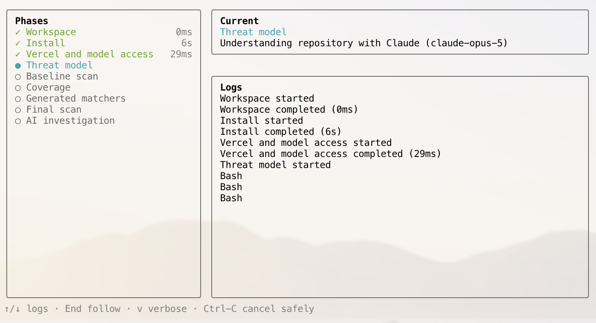
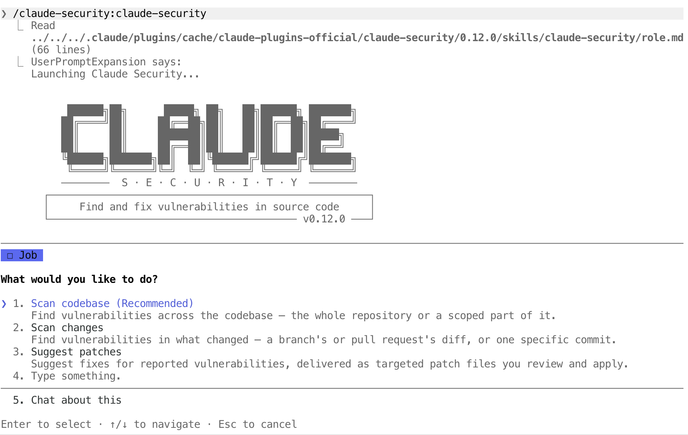
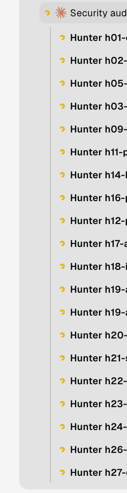

# AI security audit for mere mortals

There's a lot of talk in the news about big AI companies (allegedly) accidentally hacking other big companies with their swarms of agents, new critical vulnerabilities being found everywhere and so on. So I decided to explore what someone on a regular Claude or Codex subscription can actually do to protect their code.

The information in this post is likely to become hopelessly outdated in less than 6 months, but I believe that it's good to get a snapshot of what's already out there and see where we are.

## The lay of the land

Many popular options target API access only, where you're billed per token, which can feel scary. So I stuck to tools that work with AI subscriptions and picked the three most promising.

### Deepsec CLI

First stop, [Deepsec](https://github.com/vercel-labs/deepsec) CLI from Vercel:

- Ships with its own CLI/harness and a recommended list of models tested against their own [benchmark](https://vercel.com/blog/deepsecbench-evaluating-model-performance-in-finding-cybersecurity-vulnerabilities)
- Going by their defaults, it's very token-hungry (Opus 5 on max effort, baby!), especially since almost all subagents use the same model and effort as the main agent
- Doesn't handle usage limits gracefully yet, so it will likely require multiple restarts depending on your subscription tier

### Anthropic security scan plugin

Next up, a [security scan plugin](https://code.claude.com/docs/en/claude-security) from Anthropic:

- Limited to Claude only (duh)
- Installs as a plugin, which leads to a nicer integration, including pausing when hitting usage limits
- Similar to Deepsec, relies purely on static analysis and doesn't validate findings
- Unlike Deepsec, assigns a specific model and effort level to each agent, which makes it much more efficient in token usage
- Streamlined flow to generate patches for vulnerabilities with the "Suggest patches" option
- Proprietary license

### Cloudflare security audit skill

Last but not least, the [security audit skill](https://github.com/cloudflare/security-audit-skill) from Cloudflare:

- Takes a very similar recon + deeper research approach to the previous two
- Attempts to verify all findings in an available sandbox (e.g. Docker)
- By default, spawns subagents at the same effort level as the main agent, so running it at max effort is an absolute no-go
- The only one that triggered Claude's safety guardrails, even though it was for a seemingly benign reason

## Verdict

I ran them against a decently sized codebase. Side by side, the security audit skill from Cloudflare came up with the most verified findings, likely because it was doing multiple passes and attempting to verify all the findings in a sandbox. The Claude Code plugin contained quite a few duplicates but was a close second. Deepsec felt rather unwieldy and, despite the promising benchmarks, was about on the same level as the Claude Code plugin but contained many more general findings which can be classified as bugs rather than security issues.

All in all, there seem to be quite a few options available, likely even more if one ventures into black-box testing and makes use of models with fewer safety guardrails (DeepSeek or GLM, for example), but even with something that's already publicly available I was able to find a decent number of major issues that had accumulated in the codebase over the years.

And remember, kids, the only way to stop a bad guy with an AI agent is a good guy with an AI agent /s.
